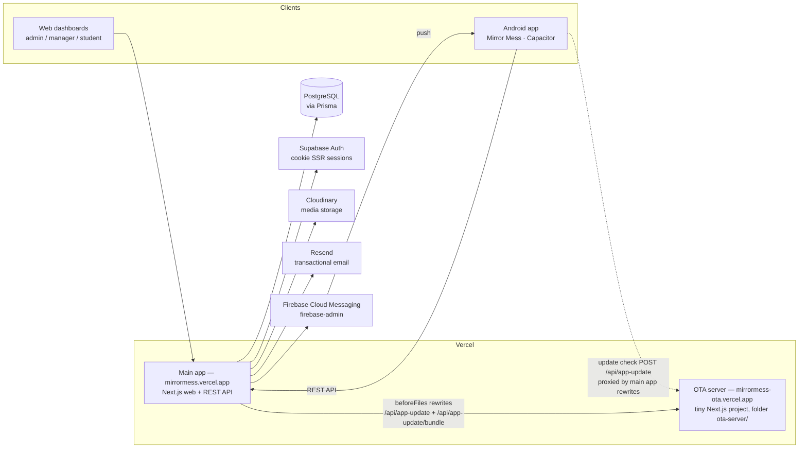

# Mirror Mess

**A complete hostel / mess management system — web platform + Android app — covering admissions, beds, billing, payments, notices and push notifications for student hostels.**

Mirror Mess is used to run residential student hostels end to end: hostel and bed inventory, student admissions with documents and a GPS-tagged selfie, monthly billing (rent, bed fee, establishment fee) with late fees, UPI payments with proof verification, a billing register with print-ready exports, three-tier announcements, and Firebase push notifications. Staff work from a role-based web dashboard and from the Android app; students use the app (and the web) to see their bills, pay by UPI, upload payment proof, read notices and track dues.

> **Current production state (2026-10-21):** web + API live at `mirrormess.vercel.app` · Android app **Mirror Mess v1.13.0** (native, `com.mirrormess.app`) with self-hosted OTA web-bundle **1.13.4** · OTA endpoints served by the standalone OTA server at `mirrormess-ota.vercel.app`.

---

## Table of contents

- [System overview](#system-overview)
- [Architecture](#architecture)
- [Technology stack](#technology-stack)
- [Features](#features)
  - [Accounts, roles and access control](#accounts-roles-and-access-control)
  - [Hostels, rooms and beds](#hostels-rooms-and-beds)
  - [Students and admissions](#students-and-admissions)
  - [Profile completion, documents and selfie](#profile-completion-documents-and-selfie)
  - [Billing engine](#billing-engine)
  - [Payments](#payments)
  - [Announcements (notices)](#announcements-notices)
  - [Push notifications](#push-notifications)
  - [Reports](#reports)
  - [Android app specifics](#android-app-specifics)
- [Data model](#data-model)
- [API overview](#api-overview)
- [OTA (over-the-air) update system](#ota-over-the-air-update-system)
- [Cron jobs](#cron-jobs)
- [Deployment](#deployment)
- [Local development and builds](#local-development-and-builds)
- [Environment variables](#environment-variables)
- [Product rules and conventions](#product-rules-and-conventions)
- [Security notes](#security-notes)
- [Project layout](#project-layout)
- [Version history](#version-history)
- [Roadmap and deferred items](#roadmap-and-deferred-items)
- [Credits](#credits)

---

## System overview

Mirror Mess replaces the paper register and spreadsheet workflow of a student hostel:

- **Super Admin** runs the whole operation across all hostels.
- **Hostel Managers** run individual hostels — students, beds, billing, documents, payments.
- **Monthly Managers** handle month-scoped duties (the server includes a mess-accounting module with monthly sessions; see [Features](#features)).
- **Students** are admitted with a profile, documents and a selfie, allotted a bed, billed monthly, and pay through UPI with a per-bill QR code; staff verify each payment from the proof the student uploads.

The system has three deployable parts:

1. **Web platform + API** (`hostel-app`, this repository) — a Next.js application that serves the staff/student web dashboards and the REST API that everything else talks to.
2. **Android app** ("Mirror Mess") — a separate codebase (Capacitor) that talks to the same API. It is the primary interface for students and is also used by staff on phones.
3. **OTA update server** (folder `ota-server/` in this repository) — a tiny standalone Next.js project that serves web-bundle updates to the Android app, so app UI updates ship in about a minute without rebuilding the main platform.

## Architecture



Key architectural points:

- **One API, two front-ends.** The web dashboards are server-rendered Next.js pages; the Android app is a separate vanilla-JS codebase that consumes the same REST API (`/api/...`, also aliased as `/api/v1/...` via a rewrite in `next.config.ts`).
- **The Android app's UI is updatable over the air.** The app shell (native) is installed once from an APK; its web bundle (screens, styling, JS logic) is updated through the self-hosted OTA system described in [OTA update system](#ota-over-the-air-update-system). Native changes (new plugins, permissions, package changes) still ship as APKs.
- **The OTA endpoints live in two places on purpose.** The main app proxies `/api/app-update` and `/api/app-update/bundle` to the standalone OTA server (`next.config.ts` → `rewrites().beforeFiles`). The copies of those routes inside the main app remain as a rollback fallback: remove the rewrites and the main app serves updates itself again.
- **Cron work runs on Vercel Cron** (bill generation, late fees, payment reminders — see [Cron jobs](#cron-jobs)).
- **Region:** the Vercel deployment is pinned to `bom1` (Mumbai) in `vercel.json`.

## Technology stack

### Web platform + API (this repository)

| Layer | Technology |
|---|---|
| Framework | Next.js **16.2.9** (App Router), React **19.2.4**, React DOM 19.2.4 |
| Language | TypeScript 5 |
| Styling / UI | Tailwind CSS 4 (`@tailwindcss/postcss`), shadcn components (`shadcn` 4.11), Base UI (`@base-ui/react`), lucide-react icons, `next-themes`, Sonner toasts, cmdk |
| Forms / validation | react-hook-form + `@hookform/resolvers`, Zod 4 |
| Data fetching (web) | SWR 2.4 |
| Database | PostgreSQL, accessed through **Prisma 5.22** (`@prisma/client`, `pg` driver) |
| Auth | Supabase Auth — `@supabase/supabase-js` + `@supabase/ssr` (cookie-based SSR sessions), route protection in `src/middleware.ts` |
| Media storage | Cloudinary (`cloudinary` SDK) for uploaded documents, selfies and proofs |
| Email | Resend (`resend` SDK) |
| Push notifications | Firebase Cloud Messaging via `firebase-admin` 14.5 |
| PDFs (server) | jsPDF 4.2 + jspdf-autotable 5 (admission form, invoices) |
| QR codes (server) | `qrcode` 1.5 |
| Password hashing | bcryptjs |
| Money math | decimal.js |
| Dates | date-fns |
| Image handling | `browser-image-compression` (web), server image helpers in `src/lib` |
| Tests | Vitest 4 (+ fast-check, vitest-mock-extended) |
| Lint | ESLint 9 + eslint-config-next |

### Android app (separate codebase — "Mirror Mess")

| Layer | Technology |
|---|---|
| Shell | Capacitor **7** (`@capacitor/core`/`android`/`cli` 7.x), Android native project, package **`com.mirrormess.app`** |
| UI code | Vanilla JavaScript (`src/app.js` + `src/api.js`), bundled with **esbuild** into a single IIFE bundle; hand-written CSS (`src/styles.css`); Public Sans font (`@fontsource/public-sans`, self-hosted woff2) |
| Design language | iOS-27-style "liquid glass": frosted/backdrop-blur chrome, flat solid colours (no gradients), light/dark/system themes |
| Native plugins | `@capacitor/app`, `@capacitor/browser`, `@capacitor/camera` (selfie/documents), `@capacitor/geolocation` (selfie GPS), `@capacitor/push-notifications` (FCM) |
| OTA updates | `@capgo/capacitor-updater` 7.53 (self-hosted mode) |
| PDFs (in-app) | jsPDF 4.2 + jspdf-autotable 5 — billing register, student-wise due report, invoices |
| QR codes (in-app) | `qrcode` 1.5 — per-bill dynamic UPI QR generated on-device |
| Custom native code | `MirrorFilesPlugin` (saves PDFs/exports to the public **Downloads** folder via MediaStore) + `MainActivity` |
| Tests | A jsdom-based smoke suite (`smoke.cjs`, run with `npm run smoke`) |
| Signing | Release/debug builds signed with a **pinned project keystore** (`android/mirror-debug.keystore`, wired through `signingConfigs` in `android/app/build.gradle`) so updates always install over the previous build |

### OTA update server (folder `ota-server/`)

| Layer | Technology |
|---|---|
| Framework | Next.js 16.2.9 / React 19.2.4 (same versions as the main app), TypeScript |
| Scope | Exactly three routes: `POST`/`GET /api/app-update` and `GET /api/app-update/bundle`, plus a status page |
| Bundle storage | The current bundle zip is stored **base64-encoded in `bundle-data.ts`** and served decoded by the bundle route (the repository is updated through a text-only channel, so the zip travels as text) |

### Tooling

- **Prisma** migrations + seed (`prisma/schema.prisma`, `prisma/seed.ts`), Prisma Studio.
- **esbuild** for the app bundle; a deterministic zip builder (`tools/make-ota-bundle.cjs` in the app project) for OTA bundles (pinned file timestamps → stable sha256).
- **Gradle** (Android builds) — the app is built offline against a pre-seeded local Maven repository in the maintainer's build environment.
- **GitHub** is the source of truth; Vercel deploys from the `master` branch.

---

## Features

### Accounts, roles and access control

- Four roles (`Role` enum): **SUPER_ADMIN**, **HOSTEL_MANAGER**, **MONTHLY_MANAGER**, **STUDENT**. Account lifecycle states: `ACTIVE` / `INACTIVE` / `SUSPENDED`.
- Email + password sign-in with session refresh, logout and forgot-password (email reset link via Resend). Auth endpoints: `/api/auth/login`, `/api/auth/refresh`, `/api/auth/logout`, `/api/auth/forgot-password`, `/api/auth/me`.
- **Route protection matrix in middleware** (`src/middleware.ts`): e.g. `/admin` is Super-Admin-only, `/manager` requires Super Admin or Hostel Manager, `/monthly-manager` is Monthly-Manager-only, `/student` allows students and staff roles. The middleware also refreshes the Supabase session and applies the CORS policy (the Capacitor app origins, localhost dev, and the production origin are allow-listed).
- **Audit logging** — administrative actions are recorded (`AuditLog` model, `/api/audit-logs`, admin audit-log page).
- **Rate limiting** helper in `src/lib/rate-limit.ts` (used e.g. on announcement creation, 30/hour).

### Hostels, rooms and beds

- Hostel CRUD with per-hostel detail pages; rooms and beds are nested resources (`/api/hostels/[id]/rooms`, `.../rooms/[roomId]/beds`), with occupancy reporting (`/api/hostels/[id]/occupancy`, `/api/reports/occupancy`).
- **Manager assignment:** hostel managers and monthly managers are assigned per hostel (`HostelManagerAssignment`, monthly-manager assignments) with assignment history.
- **Student placement:** a student is placed through hostel → room → bed assignments (`HostelAssignment`, `RoomAssignment`, `BedAssignment`), with transfer support (`/api/users/[id]/transfer`) and a full lifecycle event log (`LifecycleEvent`: JOINED / LEFT / REJOINED / TRANSFERRED_OUT / TRANSFERRED_IN).

### Students and admissions

- Admin/manager creates student accounts; users can be listed, searched, edited, activated/deactivated, downgraded, transferred, and given remarks (`Remark` model) — see the users API group.
- **Admission form PDF:** a formatted admission form is generated server-side as a PDF (`src/lib/admission-form-pdf.ts`), downloadable for any student (`/api/users/[id]/admission-form`) or by the student (`/api/users/me/admission-form`).
- Joining date management (`/api/users/[id]/joining-date`) and per-user history (`/api/users/[id]/history`).

### Profile completion, documents and selfie

- A student account starts with `isProfileComplete = false`. Completing the profile is a guided flow (web wizard at `/student/complete-profile`; the Android app enforces the same flow as a locked, step-by-step onboarding gate for students whose profile is incomplete):
  1. Personal details, 2. Address, 3. Medical details (optional), 4. **Documents** (at least one), 5. **Selfie**.
- Profile submission: `POST /api/profile/complete` (validated with Zod); completion is finalised with `PATCH /api/profile/mark-complete`, which requires a submitted profile, at least one document, and a current selfie.
- **Documents:** Aadhaar, Voter Card, Passport, Driving Licence, PAN Card (`DocumentType`), each with a verification state (`PENDING` / `APPROVED` / `REJECTED`); staff verify or reject documents from the admin/manager document queues (`/api/documents`, `/api/documents/[id]/verify`). Students cannot delete their own documents; staff can (with confirmation in the app).
- **Selfie with location:** the selfie is captured in-app with the camera plus GPS coordinates (the app shows a location disclosure before the system permission prompt, per Play policy); uploads go to `/api/selfie/upload`. Admins can require a fresh selfie (`needsSelfieUpdate`, `/api/users/[id]/selfie-permission`).
- **Profile edit requests:** students can request corrections to a locked profile; admins review them (`ProfileEditRequest`, `/api/profile/edit-request`, `/api/admin/profile-requests`).
- **Every image uploaded from the app** (documents, payment proofs, selfie) **is compressed on-device to ≤ 50 KB (JPEG) before upload** — the original never leaves the phone.

### Billing engine

Full detail in [Billing engine](#billing-engine-1) below; in short: configurable per-student rent, a yearly bed fee and a one-time establishment fee; bills generated automatically on the 1st of the month; due date the 7th; late fee ₹10/day; a register view with monthly totals and CSV/PDF exports.

### Payments

- **Per-bill dynamic UPI QR (in the app):** each unpaid bill renders its own QR encoding the exact payable amount (2-decimal), a note identifying the bill (e.g. "Mess Bill Oct 2026 – <Student Name>") and a unique transaction reference. (A hand-typed `upi://pay` link is not used for payment because the merchant VPA rejects it; a static QR image is kept in the app as a fallback/reference.)
- **Proof upload:** after paying, the student uploads a screenshot/proof (compressed to ≤ 50 KB); the payment lands as `PENDING_REVIEW`.
- **Verification queue:** staff approve or reject payments (`PATCH /api/payments/[id]/verify`). A rejection requires a reason (quick-pick reason chips in the app), and the student is notified with the reason via a private notice.
- Payment states: `PENDING_REVIEW` / `APPROVED` / `REJECTED`. Categories: `RENT`, `ESTABLISHMENT_FEE`, `BED_FEE`, `MESS_CHARGE`, `LATE_FEE`, `ALL`, `OTHER`.
- **Invoice PDF** per bill (`/api/billing/bills/[id]/invoice`), generated with jsPDF on the server; in-app bill screens show the amount breakdown including any late fee read from the server.
- Staff can share a **monthly summary over WhatsApp** from the app, and use the **Remind** action on overdue bills.

### Announcements (notices)

Three audiences, one compose flow (`Announcement` model, `AnnouncementAudience`):

| Audience | Who sees it |
|---|---|
| `GLOBAL` | Every user (public notice board) |
| `HOSTEL` | Students of one hostel only (`hostelId` required) |
| `PRIVATE` | Exactly one user (`targetUserId`) — also used by the system itself for payment confirmations, rejection reasons and reminders |

- Composed from the web or **from the Android app** (staff notice composer with templates, e.g. a rent-due template that injects the month/year and the ₹10/day late-fee note). Title 1–120 chars, body 1–2000 chars.
- Read-time audience resolution (a transferred student sees the notices of the hostel they belong to *now*); hostel managers can post only to their own hostels; notices support pinning and expiry.
- Reading: one read path `GET /api/announcements?scope=mine`; per-notice read receipts (`AnnouncementRead`, `/api/announcements/[id]/read`). Composing a notice also fires a push notification (see below).
- In-app, students get a dedicated **Notices** tab with an unread badge; staff get an announcements section with compose.

### Push notifications

- Firebase Cloud Messaging (HTTP v1 API via `firebase-admin`). Devices register their FCM token with `POST /api/devices` (upsert by token); tokens are removed on logout (`DELETE /api/devices`, scoped to the calling user) and stale tokens are pruned automatically when FCM reports them dead. Sends are batched (≤ 500 tokens per batch) and deep-link into the app (Android notification channel `hostel_updates`).
- **Triggers** (`PushEvent` in `src/lib/push.ts`): `NOTICE` (new announcement, excluding the sender), `INVOICE_DOWNLOADED` (a bill invoice was downloaded — with a 5-minute cooldown and self-download suppression), `BILL_GENERATED`, `LATE_FEE_ADDED`.
- **Ops controls:** `PUSH_ENABLED` is a global kill switch; `PUSH_PILOT_USER_IDS` optionally restricts delivery to a pilot allowlist.

### Reports

- Billing register (see below), occupancy report, payments reports (including an annual view), student report (`/api/reports/students`, `/api/reports/payments`, `/api/reports/payments/annual`, `/api/reports/occupancy`).
- The web admin area mirrors these as pages (reports: students / payments / occupancy / mess).

### Android app specifics

- **Role-based home + bottom navigation:** staff see an action dashboard (pending documents with a badge, pending payments, overdue counts, quick actions); students see a hostel dashboard — greeting, their hostel, next-due chip with countdown, attention centre for pending items.
- **Multi-account switcher:** up to **3 accounts** can be signed in on one phone (`MAX_ACCOUNTS = 3`) with instant switching; caches are namespaced per account, and the FCM token is registered **only for the active account**.
- **Offline support:** read data is cached per account for offline viewing, and actions that fail offline (e.g. a payment-proof submission) are queued and flushed when connectivity returns.
- **Billing register on the phone** with sticky student-name column, monthly totals, a year stepper, and the exports described below.
- **Settings:** Light/Dark/System theme, reduce-transparency toggle (flattens the glass effects), animations and haptics toggles, cache controls, API/server status (reads `/api/app/config`), and an About section that shows the app (native) version, the active UI bundle version, and the minimum/latest app versions from the version policy.
- **Legal:** the Privacy Policy and Terms are bundled in the app (`src/legal/`) and readable offline from Settings and the login screen.
- **Student home header** shows the greeting on its own small line with the student's name at full title size below it (bundle 1.13.1).

---

## Billing engine

Implemented in `src/lib/billing.ts` (generation + totals) and `src/lib/late-fee.ts` (late fees); configuration endpoints under `/api/billing/config`.

**Charge types** (`BillType` / `FeeType`):

| Bill type | Fee type | How it is charged |
|---|---|---|
| `RENT` | `RECURRING` | Per student per month; amount comes from the student's rent configuration (`RentConfig`, `/api/billing/config/rent`) |
| `BED_FEE` | `YEARLY` | Once per year (`BedFee`, `/api/billing/config/bed`) |
| `ESTABLISHMENT_FEE` | `ONE_TIME` | Once, at admission (`EstablishmentFee`, `/api/billing/config/establishment`) |

**Generation & due dates**

- Monthly bills are generated automatically by cron at **09:00 on the 1st** of each month (`/api/cron/generate-bills`), and can also be generated manually (`/api/billing/generate`).
- The **due date is the 7th of the bill's month**. If a bill is generated *after* the 7th, the stored due date becomes *generation date + 7 days* (see `billing.ts` — this matters for the display rule below). One-time/yearly fee bills created manually get a due date of +14 days; the yearly bed fee falls due on 31 January.
- Bill states (`BillStatus`): `GENERATED` → `PARTIALLY_PAID` → `PAID`, or `OVERDUE`. Staff can correct a bill's status (`PATCH /api/billing/bills/[id]/status`).

**Late fee**

- **₹10 per day** (`LATE_FEE_PER_DAY = 10` in `src/lib/late-fee.ts`), calculated by a daily cron (`/api/cron/calculate-late-fees`), recorded per bill in `LateFeeRecord` and added to the bill total. The calculation is idempotent (safe to run repeatedly) and every addition notifies the student and fires a `LATE_FEE_ADDED` push.
- The daily rate is a server constant; the app always displays the `lateFee` value returned by the server for each bill.

**The 7th-of-month display rule (Android app)**

Because late-generated bills carry a stored due date of *generation + 7 days*, they would not *look* overdue on their due date. The app therefore displays a monthly bill as **OVERDUE as soon as today passes the 7th of the bill's own month and money is still owed** — regardless of the server's stored due date or status. Paying on the 7th is on time; the bill flips to overdue on the 8th. Bills with no month (the fee bills) fall back to the stored due date/status. This is a **display-only** rule in the app (single source: `billIsOverdue()` + `effectiveDueDate()` in the app code, which also drives the due-countdown chips, the Remind action and the register highlighting). The server's stored status and its late-fee computation are unchanged.

**Billing register**

`GET /api/billing/register?hostelId=&year=` returns one row per student with the bed fee, establishment fee and a cell for each month (bill amount, total, status, due date, payments). In the app (and web) the register shows students × months with sticky names and monthly totals. Exports:

- **CSV** — spreadsheet-friendly (UTF-8 BOM + CRLF for Excel), with numeric month cells, per-student *Overdue Months* and *Overdue Amount* columns, a summary block, and an **OVERDUE DETAILS** section (student, month, amount due, due date, days overdue — worst first). The export always uses the year currently displayed (year stepper).
- **Designed PDF** — A4 landscape, flat slate header band, legend, generated with jsPDF + autotable. Every filled month cell prints a **status word** under the amount — `Paid`, `Due`, `Part · due Rs X`, `OVERDUE` (fee cells likewise: `Paid` / `unpaid`) — so a **black-and-white printout stays readable**: colour is only reinforcement, the word carries the meaning (bundle 1.13.2). *Note: the PDF prints `Rs` instead of `₹` because jsPDF's built-in fonts have no ₹ glyph.*
- **Student-wise due report** ("Due PDF", bundle 1.13.4) — pick a month/year; the report lists only students who owe money up to that month (this year and the previous year are both considered), with the **due month names beside each student's name** (previous-year months suffixed, e.g. `Nov '25`), the count of due months and the total due per student, sorted most-due first. If nobody owes anything, the PDF states that instead ("all clear").

Cell state in the screen, the PDF and the CSV all come from one shared classification helper in the app code, so the three can never disagree: a month counts as due/overdue only when money is still outstanding after approved payments; ₹0 placeholder bills are never overdue.

**Mess accounting (server module)**

The server also contains a mess (food) accounting module: monthly **mess sessions** per hostel with market/water expenses, guest meals (₹65/guest-meal recovery), per-student meal counts and an end-of-month **settlement** — common costs split equally plus the market balance split by meals taken (`src/lib/mess-calculator.ts`, `MessSession`, `MessSettlement`, routes under `/api/mess`). The Android app does not expose mess management, and the app-config endpoint currently reports the `mess` feature flag as off (see [API overview](#api-overview)).

---

## Data model

PostgreSQL via Prisma (`prisma/schema.prisma`, ~30 models). The core entities and relations:

**People & access**

- `User` — one login per person: unique username + email, optional `passwordHash`, `role`, account `status`, profile flags (`isProfileComplete`, `isFirstLogin`, `needsSelfieUpdate`).
- `StudentProfile` — the student's admission record (personal/address/medical details), 1:1 with a student `User`.
- `Remark` — staff remarks on a student. `ProfileEditRequest` — a student's request to change locked profile data, with review status (`RequestStatus`).
- `Device` — FCM token registrations for push (token ↔ user).

**Documents & identity**

- `Document` — an uploaded identity document: type (`DocumentType`), file reference, verification `DocumentStatus`.
- `Selfie` — the student's selfie records (with capture metadata), used by the selfie-freshness flow.

**Hostels & placement**

- `Hostel` → `Room` → `Bed` (beds are the allocatable unit; occupancy is derived from assignments).
- `HostelAssignment` / `RoomAssignment` / `BedAssignment` — a student's placement, each with `AssignmentStatus` (`ACTIVE` / `INACTIVE` / `TRANSFERRED`).
- `LifecycleEvent` — append-only history of joins, leaves, re-joins and transfers.
- `HostelManagerAssignment` — which managers run which hostels; `MonthlyManagerSession` — a monthly manager's month of responsibility.

**Billing & payments**

- `RentConfig`, `BedFee`, `EstablishmentFee` — the charge configuration (recurring rent per student, yearly bed fee, one-time establishment fee).
- `Bill` — one charge against one student: `BillType`, month/year for monthly bills, amount, `lateFee`, `totalAmount`, `dueDate`, `BillStatus`.
- `Payment` — money received/claimed against a bill: category (`PaymentCategory`), amount, proof reference, `PaymentStatus` (`PENDING_REVIEW` / `APPROVED` / `REJECTED`).
- `LateFeeRecord` — each late-fee accrual applied to a bill (audit trail for the ₹10/day charges).

**Mess accounting**

- `MessConfig`, `MessSession` (one month, `MessSessionStatus`: `DRAFT` / `UNDER_REVIEW` / `CLOSED`), `MessInitialContribution`, `MessMarketExpense`, `MessWaterExpense`, `MessGuestMeal`, `MessStudentMealCount`, `MessSettlement`, `MessDocument`.

**Communication & system**

- `Announcement` (`audience`: `GLOBAL` / `HOSTEL` / `PRIVATE`, optional `hostelId` / target user, pin + expiry) and `AnnouncementRead` (read receipts).
- `Notification` — in-app notification records (e.g. bill generated, payment results).
- `AuditLog` — who did what, for administrative actions.

## API overview

All routes are Next.js route handlers under `src/app/api`. Responses use a `{ success, data }` envelope via `src/lib/api-response.ts` — **except** `/api/app-update`, which intentionally returns the bare JSON the Capgo plugin parses. The same API is reachable under `/api/v1/*` (rewritten to `/api/*`). Interactive documentation is served from the API itself (`/api/docs`, `/api/docs/openapi.json`, generated from `src/lib/openapi-spec.ts`).

| Area | Routes (highlights) |
|---|---|
| Auth | `POST /api/auth/login`, `POST /api/auth/refresh`, `POST /api/auth/logout`, `POST /api/auth/forgot-password`, `GET /api/auth/me` (returns the session user — role, hostel assignment, full name) |
| App config | `GET /api/app/config` — public; version gate + feature flags (below) |
| App update (OTA) | `POST`/`GET /api/app-update`, `GET /api/app-update/bundle` — see [OTA](#ota-over-the-air-update-system) |
| Users | `GET/POST /api/users`, `GET/PATCH /api/users/[id]`, `.../assign`, `.../transfer`, `.../status`, `.../downgrade`, `.../email`, `.../reset-password`, `.../joining-date`, `.../history`, `.../remarks`, `.../selfie-permission`, `.../admission-form` (PDF), `GET /api/users/me/admission-form`, `GET /api/users/session` |
| Profile | `POST /api/profile/complete`, `PATCH /api/profile/mark-complete`, `POST /api/profile/edit-request`, `POST /api/profile/privacy-consent`, `GET /api/admin/profile-requests` (+ review) |
| Documents & selfie | `GET/POST /api/documents`, `POST /api/documents/upload`, `PATCH /api/documents/[id]/verify`, `DELETE /api/documents/[id]`, `POST /api/selfie/upload`, `POST /api/uploads` |
| Hostels | `GET/POST /api/hostels`, `GET/PATCH /api/hostels/[id]`, `.../rooms`, `.../rooms/[roomId]`, `.../beds`, `.../managers`, `.../monthly-managers`, `.../students`, `GET /api/hostels/[id]/occupancy` |
| Billing | `GET /api/billing/register`, `POST /api/billing/generate`, `GET /api/billing/config` (+ `/rent`, `/bed`, `/establishment`), `GET /api/billing/bills/[id]`, `PATCH /api/billing/bills/[id]/status`, `GET /api/billing/bills/[id]/invoice` (PDF), `GET /api/billing/bills/month-status` |
| Student billing views | `GET /api/student/bills`, `GET /api/student/payments` |
| Payments | `GET/POST /api/payments`, `PATCH /api/payments/[id]/verify` (accepts a rejection reason) |
| Announcements & notifications | `GET/POST /api/announcements` (`?scope=mine`), `DELETE /api/announcements/[id]`, `POST /api/announcements/[id]/read`, `GET /api/notifications`, `POST /api/notifications/read-all`, `POST /api/notifications/[id]/read` |
| Devices (push) | `POST /api/devices` (register FCM token), `DELETE /api/devices` (unregister, scoped to the caller) |
| Mess | `/api/mess/config`, `/api/mess/sessions` (+ `/close`, `/expenses`, `/guests`, `/meal-counts`) |
| Reports | `/api/reports/students`, `/api/reports/payments`, `/api/reports/payments/annual`, `/api/reports/occupancy`, `/api/reports/mess` |
| Admin & system | `GET /api/admin/dashboard`, `GET /api/audit-logs`, `/api/cron/*` (see [Cron jobs](#cron-jobs)) |

**The app-facing contract** (what the Android app depends on):

- `GET /api/app/config` → `{ minAppVersion, latestAppVersion, maintenance, maintenanceMessage, features: { mess, uploads } }`. The app fetches this unauthenticated at startup: if `maintenance` is true it shows the maintenance gate; if its own version is below `minAppVersion` it shows the "update required" gate. Values come from environment variables (`APP_MIN_VERSION`, `APP_LATEST_VERSION`, `APP_MAINTENANCE`, `APP_MAINTENANCE_MESSAGE`) with defaults in the route.
- `GET /api/auth/me` — the app's session bootstrap; returns the session user directly (single query), including role plus the active hostel assignment/fallbacks and full name.
- Everything else the app calls uses the same cookie/token session and the tolerant response shapes above; the app merges responses defensively so server additions don't break older bundles.

## OTA (over-the-air) update system

From native **v1.13.0**, the Android app updates its own web UI over the air — no APK, no reinstall — using `@capgo/capacitor-updater` in **self-hosted** mode (stats and channel URLs are disabled in `capacitor.config.json`; the app talks only to this system's own endpoints, never to Capgo's cloud).

**How a check works**

1. On launch, the plugin POSTs the device's current bundle version (`version_name`), native build (`version_build`), platform and device id to `https://mirrormess.vercel.app/api/app-update`.
2. If the published bundle is the same, the server answers `{ message: "No new version available", kind: "up_to_date", error: "no_new_version_available" }`. If a newer bundle exists, it answers `{ version, url, checksum }` — the **sha256 checksum is mandatory**; the plugin rejects downloads without one ("Checksum required").
3. The app downloads the zip from `GET /api/app-update/bundle` in the background, verifies the checksum, and **applies it on the next launch**. After a successful boot the app calls the plugin's ready notification; if a bundle ever fails to start, the plugin **rolls back automatically** to the previous bundle.
4. Version comparison is by equality against the published version, so publishing an *older* bundle version is also the **rollback path**.

**Where it is hosted (since 2026-10-21)**

Update checks still arrive at `mirrormess.vercel.app` (that URL is baked into the installed APKs), but the main app **proxies the two paths to a tiny standalone Next.js project** — folder `ota-server/` in this repo, deployed as its own Vercel project at **`mirrormess-ota.vercel.app`** — via `beforeFiles` rewrites in `next.config.ts`. The tiny project builds in seconds, so bundle publishes go live in about a minute instead of waiting for a full build of the main platform. The main app also keeps its own copies of the update routes as a fallback: delete the rewrites and it serves updates itself again.

The bundle zip itself is stored **base64-encoded in `bundle-data.ts`** inside the OTA project (and the fallback copy) and is served decoded by the bundle route, because this repository is updated through a text-only channel that cannot carry binary files.

**Publishing a UI update**

1. In the app project: make the change in `src/`, bump the bundle version (`package.json` + `APP_VERSION` in `src/api.js`).
2. Run `npm run ota:bundle` — builds the web bundle, creates `dist-ota/mirror-bundle-<version>.zip` (contents of `www/`, `index.html` at the zip root, byte-deterministic), prints its sha256, and refreshes the server packages (regenerates `bundle-data.ts`, bumps `LATEST.version` + `LATEST.checksum` in the route).
3. Push the refreshed OTA copies — the **`ota-server/` copies are the live ones**; the main-app fallback copies are kept in sync in the same step.
4. The tiny Vercel project redeploys (~a minute). Phones pick the bundle up within one launch cycle. **No APK is produced for OTA releases.**

**Version policy (native versions)**

Published alongside the bundle in the OTA route (`LATEST.minNativeVersion` / `LATEST.latestNativeVersion`) and read by the app via `GET /api/app-update` → `{ minNativeVersion, latestNativeVersion, latestBundleVersion }`. The app reads its **real** native version from the updater plugin (`getBuiltinVersion()` — which is why a `version` key must never be set in the `CapacitorUpdater` config: the plugin would report that instead of the real build):

- Native **below minimum** → a blocking "This app version is no longer supported — please install the latest version" screen.
- Native **below latest** (but ≥ minimum) → a dismissible "a new app version is available" banner on Home.
- Equal/above, or the check fails (offline) → nothing. The check never blocks startup.

**Standing rule:** with *every* release, the minimum and latest app-version values are reviewed and updated too — `latestNativeVersion` (and the `/api/app/config` values) move when a new APK ships; the minimum is raised only when an old native version must be retired.

**What OTA cannot do:** change native code — new Capacitor plugins, permissions, the package name, or the native version itself. Those ship as a new APK (signed with the same pinned keystore, so they install as updates).

## Cron jobs

Defined in `vercel.json`, executed by Vercel Cron, protected by a shared cron secret (`CRON_SECRET`):

| Path | Schedule (cron, UTC) | What it does |
|---|---|---|
| `/api/cron/generate-bills` | `0 9 1 * *` — 09:00 on the 1st | Generates the month's bills for all students |
| `/api/cron/calculate-late-fees` | `0 10 * * *` — daily 10:00 | Accrues ₹10/day late fees on overdue bills and notifies students |
| `/api/cron/send-payment-reminders` | `0 9 5 * *` — 09:00 on the 5th | Sends payment reminders ahead of the 7th due date |

## Deployment

- **Source of truth:** GitHub repository `ReOneSec/hostel-app`, branch `master`.
- **Vercel project 1 — main platform:** imports the repo root; auto-deploys on push to `master`; serves `mirrormess.vercel.app` (region `bom1`). A full build of the platform takes minutes — this is exactly why the OTA endpoints were moved out.
- **Vercel project 2 — OTA server:** imports the *same* repo with **Root Directory = `ota-server`**; serves `mirrormess-ota.vercel.app`; redeploys in ~a minute when the `ota-server/` files change.
- **Android app:** distributed as a **signed APK** (direct install/update; an AAB is produced only when needed for Play Store submission). OTA bundles then keep the UI current between APK releases.
- **Database:** hosted PostgreSQL (connection via `DATABASE_URL` / `DIRECT_URL`); Supabase provides Auth (and its project hosts the database in the current setup).

## Local development and builds

### Web platform / API (this repo)

```bash
npm install            # also runs prisma generate (postinstall)
cp .env.example .env   # fill in the variables listed below (if the file is absent, create .env from the table)
npm run dev            # Next.js dev server on http://localhost:3000
npm run build          # production build
npm run start          # serve the production build
npm run lint           # ESLint
npm test               # Vitest suite
npm run db:push        # push the Prisma schema to the database (dev)
npm run db:migrate     # create/apply a migration
npm run db:seed        # seed the database (tsx prisma/seed.ts)
npm run db:studio      # Prisma Studio
npm run db:lockdown-rls   # apply the RLS lockdown script (see Security notes)
```

### OTA server

```bash
cd ota-server
npm install
npm run dev            # or: npm run build && npm run start
# sanity checks:
curl https://<ota-domain>/api/app-update            # version policy JSON
curl -X POST https://<ota-domain>/api/app-update    # with a Capgo-style JSON body → offer JSON
```

### Android app (separate project)

```bash
npm install
npm run bundle         # build the web bundle into www/ (esbuild + assets + legal pages)
npm run smoke          # jsdom smoke suite (run before every release)
npm run sync           # bundle + cap sync android
npm run ota:bundle     # build an OTA bundle zip + refresh the server packages
# native build (from android/): Gradle assembleDebug / assembleRelease
```

- The Android project pins its **signing keystore in the project** (`android/mirror-debug.keystore`, referenced by both debug and release `signingConfigs`) — do not replace it, or updates will fail to install over existing installs (`INSTALL_FAILED_UPDATE_INCOMPATIBLE`).
- Web-layer-only changes should normally ship as an **OTA bundle**, not an APK.

## Environment variables

Names and purposes only — values live in the Vercel project settings / local `.env`, never in this repository.

**Main platform**

| Variable | Purpose |
|---|---|
| `DATABASE_URL` | PostgreSQL connection string used by Prisma at runtime |
| `DIRECT_URL` | Direct (non-pooled) PostgreSQL connection for Prisma migrations |
| `NEXT_PUBLIC_SUPABASE_URL` | Supabase project URL (auth) |
| `NEXT_PUBLIC_SUPABASE_ANON_KEY` | Supabase anonymous key (browser/SSR auth) |
| `SUPABASE_SERVICE_ROLE_KEY` / `SUPABASE_SERVICE_KEY` | Supabase service-role access for server-side auth/admin operations |
| `NEXT_PUBLIC_APP_URL` | Public base URL of the web app (used in CORS checks and links) |
| `APP_BASE_URL` | Base URL used when generating absolute links (e.g. in emails/PDFs) |
| `CLOUDINARY_CLOUD_NAME`, `CLOUDINARY_API_KEY`, `CLOUDINARY_API_SECRET` (or `CLOUDINARY_URL`) | Cloudinary media storage credentials |
| `RESEND_API_KEY` | Resend transactional email |
| `FIREBASE_PROJECT_ID`, `FIREBASE_CLIENT_EMAIL`, `FIREBASE_PRIVATE_KEY` | Firebase service-account credentials for FCM push (server-side only) |
| `PUSH_ENABLED` | Push kill switch (`false` disables all sends) |
| `PUSH_PILOT_USER_IDS` | Optional comma-separated allowlist to pilot push to specific users |
| `APP_MIN_VERSION` | Minimum app version returned by `/api/app/config` (older apps are gated) |
| `APP_LATEST_VERSION` | Latest app version returned by `/api/app/config` |
| `APP_MAINTENANCE` | `true` puts the app/web into maintenance mode |
| `APP_MAINTENANCE_MESSAGE` | Message shown while maintenance mode is on |
| `CRON_SECRET` | Shared secret required by the `/api/cron/*` endpoints |
| `NODE_ENV` | Standard Node environment flag |

**OTA server:** no environment variables — the published bundle version, checksum and the min/latest native policy live in its `route.ts` (`LATEST`) and are updated by the publish flow.

**Android app:** no secrets are embedded; the only baked-in endpoints are the API base and the OTA `updateUrl` in `capacitor.config.json`. (The Firebase *client* configuration file `google-services.json` is placed in the Android project at build time for FCM registration; the service-account key is server-side only and must never be committed or shared.)

## Product rules and conventions

These are standing decisions of the project — follow them in any change:

1. **Flat colours only on the web platform** — no gradient colours anywhere in the web UI; solid slate/white/blue palette. (The Android app uses flat colours too, with glass translucency/blur as its only "effect".)
2. **APK-only releases** — Android releases ship as APKs; an AAB is built only when a Play Store submission needs one.
3. **Every uploaded image ≤ 50 KB** — documents, payment proofs and selfies are compressed client-side to ≤ 50 KB JPEG before upload; originals are never uploaded.
4. **Min/latest app versions move with every release** — see the version-policy rule in [OTA](#ota-over-the-air-update-system).
5. **Register consistency** — the register screen, its CSV, its PDF and the due report share one cell-classification helper; their numbers must never disagree.
6. **The 7th is the deadline** — monthly bills are due on the 7th of their month, and the app displays them as overdue from the 8th when money is owed (display rule; the server computes late fees from stored due dates).
7. **Keep the OTA fallback intact** — the main app keeps its own app-update routes as a rollback path for the standalone OTA server.
8. **No secrets in the repo** — credentials come from environment variables; the bundle zip is the only binary that travels (as base64 text) through the OTA publish flow.

## Security notes

- **Authentication** is Supabase Auth with cookie-based SSR sessions; the API also issues its own session tokens for the mobile app (login/refresh flow). Passwords are never stored in this codebase in plain text (`passwordHash` via bcryptjs where used).
- **Authorisation is enforced twice:** page-level role routing in middleware, and per-route checks on the server (e.g. hostel managers are scoped to their own hostels for notices, documents and billing).
- **Database lockdown:** Row Level Security is enabled on all application tables and direct access for the anonymous/authenticated database roles is revoked (`supabase/migrations/20261012_enable_rls_lockdown.sql`, applied via `npm run db:lockdown-rls` / `scripts/lockdown-rls.ts`). All data access goes through the Next.js server (Prisma), which bypasses RLS with the server connection — the public database roles cannot read the tables directly.
- **Push credentials** (Firebase service account) exist only as server environment variables.
- **Uploads** are validated by type, stored in Cloudinary, and — from the app — pre-compressed; the admission-form and invoice PDFs are generated on the server from database records, not from user-supplied files.
- **Cron endpoints** require the `CRON_SECRET`.
- **Privacy:** the app collects a selfie with GPS coordinates only as part of profile completion, after an in-app location disclosure and the OS permission prompt; the privacy policy and terms ship inside the app and on the web.

## Project layout

### This repository (web platform + API + OTA server)

```
hostel-app/
├── src/
│   ├── app/
│   │   ├── (auth)/login/                 # login page
│   │   ├── (dashboard)/                  # role dashboards
│   │   │   ├── admin/                    #   super admin: users, hostels, billing,
│   │   │   │                             #   documents, payments, notices, reports, audit logs
│   │   │   ├── manager/                  #   hostel manager: dashboard, documents, payments, mess
│   │   │   ├── monthly-manager/          #   monthly manager: dashboard, mess
│   │   │   └── student/                  #   student: dashboard, bills, payments,
│   │   │                                 #   documents, notices, profile, complete-profile, selfie
│   │   ├── api/                          # REST API (see API overview)
│   │   │   ├── app/config/               #   version gate + feature flags
│   │   │   ├── app-update/               #   OTA endpoints (fallback copy; live copy is in ota-server/)
│   │   │   └── ...                       #   auth, users, hostels, billing, payments,
│   │   │                                 #   announcements, devices, mess, reports, cron
│   │   ├── verify/[id]/                  # public verification page
│   │   └── page.tsx                      # landing / redirect
│   ├── lib/                              # billing.ts, late-fee.ts, auth.ts, push.ts,
│   │                                     # notify.ts, mess-calculator.ts, pdf-generator.ts,
│   │                                     # admission-form-pdf.ts, storage.ts, upload.ts,
│   │                                     # rate-limit.ts, openapi-spec.ts, prisma.ts, ...
│   ├── components/                       # shared UI components (shadcn-based)
│   ├── hooks/                            # incl. shared use-user-profile hook
│   ├── utils/supabase/                   # Supabase SSR client/server/middleware helpers
│   └── middleware.ts                     # session refresh + role route matrix + CORS
├── prisma/
│   ├── schema.prisma                     # data model (~30 models)
│   ├── seed.ts                           # database seed
│   └── migrations/                       # (plus scripts/lockdown-rls.ts)
├── supabase/migrations/                  # RLS lockdown migration
├── scripts/                              # lockdown-rls, migrate-roles, generate-openapi-json
├── public/                               # static assets
├── ota-server/                           # ★ standalone OTA update server (own Vercel project)
│   ├── app/api/app-update/               #   route.ts (POST check + GET policy),
│   │                                     #   bundle/route.ts, bundle-data.ts (base64 zip)
│   ├── app/page.tsx                      #   status page
│   ├── package.json                      #   next 16.2.9 / react 19.2.4 only
│   └── README.md                         #   its setup + publish flow
├── vercel.json                           # region (bom1) + cron schedules
├── next.config.ts                        # rewrites: /api/v1 alias + OTA proxy (beforeFiles)
└── package.json                          # scripts: dev/build/test, db:* helpers
```

### Android app project (separate repository/workspace — "Mirror Mess")

```
mirror-hostels/
├── src/
│   ├── app.js                            # all screens + logic (single-file app)
│   ├── api.js                            # API client, sessions, cache, APP_VERSION
│   ├── styles.css                        # liquid-glass design system
│   ├── index.html                        # shell
│   ├── assets/                           # bundled images (incl. fallback UPI QR)
│   └── legal/                            # privacy.html, terms.html (bundled, offline)
├── android/                              # Capacitor Android project (com.mirrormess.app)
│   └── app/src/main/java/.../            # MainActivity, MirrorFilesPlugin (Downloads saver)
├── tools/make-ota-bundle.cjs             # OTA bundle builder (zip + sha256 + server refresh)
├── server-ota/                           # staging copy of the OTA routes for the main app (fallback)
├── server-ota-fast/                      # staging copy of the standalone ota-server/ project
├── smoke.cjs                             # jsdom smoke suite
├── capacitor.config.json                 # appId, appName, CapacitorUpdater (updateUrl)
└── PLAY_STORE_CHECKLIST.md               # Play submission checklist + listing drafts
```

## Version history

Native app and OTA bundle share one version line from 1.13.0 onwards; before OTA existed, every release was an APK.

| Version | Type | Highlights |
|---|---|---|
| 1.0 – 1.6.x | APK | Core app: auth, bills, payments with UPI, documents, register; Downloads file bridge; "Mess" branding adopted (package `com.mirrormess.app`) |
| 1.7.x | APK | Dynamic per-bill UPI QR; role-based navigation; staff notice composer; reject-with-reason; due countdowns |
| 1.8.x | APK | Flat-colour redesign; ≤ 50 KB upload compression; multi-account switcher (up to 3); full liquid-glass redesign; forced student profile-completion onboarding |
| 1.9.0 | APK + AAB | Play Store readiness: bundled privacy/terms, location disclosure, release signing on the pinned keystore |
| 1.10.0 – 1.12.0 | APK | Register CSV export; designed register PDF + year stepper; the 7th-of-month overdue display rule |
| **1.13.0** | APK | **OTA self-hosted updates introduced** (Capgo updater) — the last "everything ships as APK" release |
| 1.13.1 | OTA bundle | Home header fix (greeting small, name full-size) — first OTA-only release |
| 1.13.2 | OTA bundle | Register PDF status words (B&W-print readable) — shipped inside 1.13.3 |
| 1.13.3 | OTA bundle | Native version policy (min/latest) enforced in-app |
| **1.13.4** | OTA bundle | **Student-wise monthly due PDF**; OTA hosting moved to the standalone OTA server (same day) |

## Roadmap and deferred items

- **Complaint box** — designed as a possible companion to announcements but **deferred** (recorded as a non-goal in the announcements PRD); not in the current system.
- **Server backlog items** (document-route refinements, a per-user summary endpoint, push token model change to `(token, userId)`) are tracked in the project's planning docs and land as server deploys independent of app releases.
- **Play Store listing** — the app is submission-ready (see the app project's `PLAY_STORE_CHECKLIST.md`); the store listing itself is pending the maintainer's Console steps.

## Credits

**Mirror Mess** — designed, built and maintained by the project owner (GitHub: [ReOneSec](https://github.com/ReOneSec)).

The web platform and API are built on Next.js, React, Prisma and Supabase; the Android app on Capacitor with the Capgo updater for self-hosted OTA updates.
